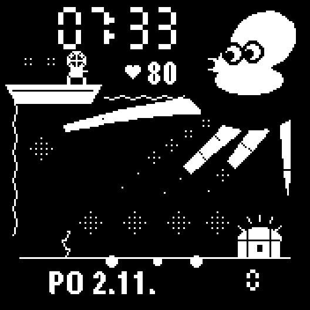

# Chobotnice

A watch face for the Garmin Instinct 3 Solar, styled after the 1981 Game & Watch game Octopus. Black and white, drawn from scratch in Monkey C.

## What it shows

- Time in seven-segment digits.
- Heart rate.
- Day and date in Czech.
- Steps as the score, bottom right.
- Step goal as the dive: the diver climbs down the rope from the boat, crosses the seabed and reaches the treasure chest when the goal is met. After that he keeps fetching gold.
- Body Battery as spare divers on the boat.
- The octopus sits in the round sub-screen window and moves its tentacles over the seabed.

## Supported watches

- Instinct 3 Solar 45 mm and 50 mm (Connect IQ device `instinct3solar45mm`)

Other watches are not built or tested.

## Build and install

1. Install the Connect IQ SDK and create a developer key.
2. Build: `monkeyc -f monkey.jungle -d instinct3solar45mm -o bin/Chobotnice.prg -y developer_key.der`
3. Connect the watch and copy `bin/Chobotnice.prg` to `Garmin/Apps`. Unplug it. The watch installs the file.
4. Pick Chobotnice from the watch face list.

## License

None yet. All rights reserved by the author.
